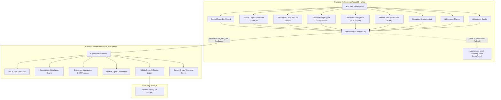

# FlowTwin AI
## Autonomous Logistics Intelligence & Interactive Supply Chain Digital Twin
### Comprehensive Project Documentation & Technical Architecture Report

---

## 1. Executive Summary

### 1.1 Project Overview
**FlowTwin AI** is a next-generation enterprise logistics command center, multi-dimensional digital twin, and disruption simulation laboratory. It transforms unstructured freight documentation (Bills of Lading, delivery orders, commercial invoices) and real-time telematics into a living, reactive topological graph model of global supply chain networks.

Modern global logistics networks face cascading vulnerabilities: severe weather closures, equipment breakdowns, terminal yard dwell chokes, and driver hours-of-service limitations. When a disruption occurs on an arterial freight corridor (such as Interstate 80 in the US Midwest), dispatchers typically react with fragmented spreadsheets and manual phone calls.

**FlowTwin AI solves this by introducing:**
1. **Interactive Spatial Digital Twin**: High-fidelity 3D spatial canvas (WebGL/Three.js) coupled with real-time cartographic tracking across US interstate corridors.
2. **Deterministic Disruption Simulation Lab**: Mathematical calculation of delay consequences, added detour distance, carrier costs ($2.45/km + $65/hr demurrage), and SLA penalty risks ($150/hr).
3. **Multi-Objective AI Recovery Planner**: Automated formulation of candidate recovery strategies (Fastest Delivery vs. Lowest Cost vs. Balanced Resilience) with automated regulatory constraint validation (FMCSA HOS rules and 80,000 lbs GVWR limits).
4. **Autonomous Dual-Mode Architecture**: Operates 100% out of the box in zero-config standalone mode (ideal for instant Vercel demos) while providing instant live streaming connectivity to a disk-persisted SQLite database on Render.

---

## 2. System Architecture

### 2.1 High-Level Architecture Diagram



---

## 3. Technology Stack

| Layer | Technologies | Key Responsibilities |
|---|---|---|
| **Frontend Framework** | React 18.3, TypeScript 5.7, Vite 6.4 | Reactive state management, component tree, hot-module reload |
| **Styling & Layout** | Tailwind CSS 3.4, Vanilla CSS Custom Design Tokens | Sleek dark-mode aesthetic (`#0A0B12`, `#121422`), glassmorphism, responsive grid |
| **3D Spatial Graphics** | Three.js, `@react-three/fiber`, `@react-three/drei` | WebGL canvas, 10 industrial facilities, terrain mesh, procedural ocean waves, vehicle fleet |
| **Cartography & Maps** | Keyless ESRI World Dark Canvas, OpenStreetMap, `@vis.gl/react-google-maps` | Real-time freight corridor polylines, facility markers, GPS vehicle heading, traffic overlay |
| **Data Visualization** | Recharts, React Flow | Daily volume area charts, delay histograms, topological supply chain graph DAGs |
| **Icons & Animation** | Lucide React, Framer Motion, Canvas Confetti | Cybernetic indicators, smooth transitions, celebration feedback |
| **Backend Runtime** | Node.js (v20+ / v24), Express 4.x, TypeScript | REST API endpoints, routing, multer file uploads, Zod schema validation |
| **Database Engine** | SQLite with WebAssembly (`sql.js`) | Zero-configuration file persistence (`./data/flowtwin.sqlite`), auto-seeding demo workspace |
| **Real-time Telemetry** | Socket.IO | Bidirectional real-time telematic event broadcasting |
| **AI Integration** | Google Gemini API (`gemini-1.5-flash`) + Deterministic Multi-Agent Engine | Natural-language query answering, document entity extraction, recovery synthesis |

---

## 4. Core Modules & Feature Breakdown

### 4.1 Operations Control Tower (`/app/dashboard`)
The central executive dashboard providing high-level operational visibility:
- **KPI Metrics**: 34 total consignments, 18 in transit, 94.2% on-time delivery rate, 5 delayed, 2 exceptions, 5 available fleet tractors.
- **Dynamic Bento Grid**:
  - Daily consignment volume rolling 7-day trend (on-time vs. delayed).
  - Delay duration distribution histogram (<2h, 2-4h, 4-8h, >8h).
  - Carrier compliance matrix (Apex Freight Dynamics, Titan Intermodal, Nexus Global, BlueSky Logistics).
  - Hub yard dwell utilization across 6 enterprise cross-dock facilities.
- **AI Operational Briefing**: Synthesizes live corridor warnings, active mechanical breakdowns, and pending recovery plans into an executive summary.

### 4.2 3D Logistics Universe (`/app/twin-3d`)
A cutting-edge WebGL spatial digital twin rendered with Three.js:
- **10 Industrial Facilities**: Coastal container terminals (Long Beach, Seattle), inland distribution cross-docks (Chicago, Dallas, Atlanta), and regional logistics hubs.
- **Exploded Warehouse Interior**: High-bay racking cutaway with automated guided vehicles (AGVs), pallet staging lanes, and inventory dwell monitors.
- **Multi-Corridor Flow Splines**: GPU-accelerated particle systems showing line-haul freight movement along I-80, I-70, I-10, I-90, and I-75.
- **Fleet Dynamics**: Real-time 3D tractor-trailer models moving with spatial velocity and heading indicators.
- **Camera Director**: 10 preset cinematic views (Orbital Drone, Line-Haul Follow, Hub Top-Down, Incident Focus, Interior Cutaway).
- **Spatial HUD Loading Overlay**: Real-time WebGL shader initialization tracker with hardware acceleration diagnostics.

### 4.3 Live Logistics Map (`/app/map`)
A dual-engine interactive cartographic visualization:
- **Autonomous Keyless Dark Map**: Powered by high-resolution ESRI ArcGIS World Dark Gray Canvas and OpenStreetMap (zero API key required).
- **Optional Google Maps Mode**: Toggleable 1-click integration with Google Maps Platform and `<AdvancedMarker>` elements.
- **Active Freight Corridors**: Native polylines representing:
  - *I-80 Midwest-Northeast Prime* (1,280 km) — with blizzard road-closure hazard marker.
  - *I-70 South Resilience Bypass* (1,395 km) — dashed detour bypass alternative.
  - *I-10 Pacific-Southern Transcon*, *I-90 Northern*, and *I-75 Southeast*.
- **Entity Inspector Drawer**: Clicking any truck, facility, or corridor opens a telematic telemetry panel showing driver credentials, cargo temperature, gross weight, and dispatch status.

### 4.4 Shipment Registry & Telematics (`/app/shipments`)
An enterprise registry of 34 active consignments:
- **Comprehensive Filtering**: Real-time filter by status (`in_transit`, `delayed`, `exception`, `ready_for_dispatch`, `delivered`), carrier, and search query.
- **Milestone Telemetry**: Detailed step-by-step breadcrumb tracking (Origin Hub Tender → Checkpoint Waypoints → Delay Advisory → Destination Cross-dock).
- **Risk Index Scoring**: Automated composite risk score (0–100) based on weather holds, temperature variances, and delivery SLA tightness.
- **CSV Export**: Instant generation and download of complete manifest telemetry in CSV format.
- **Consignment Registration Modal**: Role-gated modal to dispatch new shipments with custom origin, destination, carrier, and cargo attributes.

### 4.5 Document Intelligence Engine (`/app/documents`)
Automates document ingestion, entity extraction, and live system promotion:
- **Multi-Format Ingestion**: Drag-and-drop support for PDF Bills of Lading, commercial invoices, and CSV manifests.
- **Extracted Entity Confidence Scoring**: Identifies Shipment ID, PO number, origin/destination hubs, weight, and carrier with individual confidence metrics (0.00–1.00).
- **Discrepancy Detection**: Highlights conflicting values (e.g. gross tare weight variance between commercial invoice and manifest).
- **In-Place Field Editor**: Allows operators to review and correct OCR errors.
- **1-Click Shipment Promotion**: Automatically generates a validated live shipment from verified document records and inserts it into the active tracking registry.

### 4.6 Supply Chain Network Twin (`/app/network`)
A topological graph representation of network dependencies built with React Flow:
- **Tiered Nodes**: Facilities (tier 1), transport vehicles (tier 2), and active consignments (tier 3).
- **Disruption Blast Radius**: 1-click interactive simulation highlighting upstream and downstream nodes impacted by a corridor hold.

### 4.7 Disruption Simulation Lab (`/app/simulations`)
A signature "What-If" sandbox for logistics risk assessment:
- **Configurable Shocks**: Road closures, severe weather, mechanical breakdown, facility chokes, or port strikes.
- **Parameter Sliders**: Corridor selection, severity level, duration (1–48 hours), and facility capacity drop percentage.
- **Deterministic Math Engine**:
  - Detour Cost = $\text{Added Distance (km)} \times \$2.45/\text{km} + \text{Duration (hrs)} \times \$65/\text{hr demurrage}$
  - SLA Penalty = $\text{Projected Late Shipments} \times \text{Avg Delay (hrs)} \times \$150/\text{hr}$
- **Scenario Comparison Matrix**: Visual delta comparison between baseline operations and simulated scenarios.

### 4.8 AI Multi-Objective Recovery Planner (`/app/recovery`)
Formulates actionable contingency plans to mitigate simulated shocks:
- **Plan Alpha (Fastest Delivery)**: Hot-shot expedited team drivers + southern detour bypass via I-70 (saves 6.5h).
- **Plan Beta (Lowest Cost)**: Modal shift of non-urgent dry freight to intermodal rail flatcars.
- **Plan Gamma (Balanced Resilience)**: Priority staging for cold-chain and sensitive semiconductor cargo.
- **Regulatory Constraint Checks**: Validates FMCSA Hours of Service (11-hour driving limit rule), 80,000 lbs GVWR axle loads, and dock delivery appointments.
- **Manager Authorization**: Role-gated approval workflow with celebratory visual feedback and immutable audit logging.

### 4.9 AI Logistics Copilot & Multi-Agent Telemetry
- Conversational sidecar grounded in database records.
- Multi-agent coordination showing live reasoning traces across:
  - *Agent A (Document OCR)*: Scans and cross-references BOL records.
  - *Agent B (Risk Engine)*: Calculates contractual SLA exposure.
  - *Agent C (Disruption Lab)*: Formulates alternative detour routings.
  - *Agent D (Recovery Planner)*: Checks vehicle weights and driver hours.

### 4.10 Security, Roles & Audit Governance (`/app/admin`)
- **Interactive Role Switcher**: Quick switching between:
  - **Administrator**: Full system access, data reset, user management.
  - **Logistics Manager**: Shipment creation, simulation execution, recovery plan authorization.
  - **Operations Analyst**: Simulation experimentation, document correction, report generation.
  - **Viewer**: Read-only oversight with executive reporting.
- **Immutable Audit Trail**: Cryptographically recorded operational events (workspace resets, shipment creations, plan approvals, and OCR updates).

---

## 5. Dual-Mode Deployment Architecture

```
                    ┌──────────────────────────────────────────────┐
                    │       FlowTwin AI Frontend (Vercel)          │
                    └──────────────────────┬───────────────────────┘
                                           │
            ┌──────────────────────────────┴──────────────────────────────┐
            │                                                             │
  [No VITE_API_URL set]                                          [VITE_API_URL set]
            │                                                             │
┌───────────▼────────────────┐                                  ┌─────────▼──────────────────┐
│ Autonomous Fallback Store  │                                  │ Render Backend Service     │
│ • mockApi.ts pre-loaded    │                                  │ • Node.js / Express API    │
│ • Full in-memory filtering │                                  │ • Persistent flowtwin.sqlite│
│ • 0s loading delay         │                                  │ • Socket.IO live stream    │
└────────────────────────────┘                                  └────────────────────────────┘
```

1. **Standalone Vercel Mode (Default)**:
   - Requires zero configuration.
   - Pre-populates all 34 shipments, 3 documents, 4 alerts, and 6 facilities.
   - Code-split via `React.lazy()` for sub-second initial loading.
2. **Live Backend Render Mode**:
   - Setting `VITE_API_URL=https://<your-render-service>.onrender.com` connects the frontend to the live SQLite file database (`./data/flowtwin.sqlite`).
   - Built-in `AbortController` timeout ensures that if the free-tier backend is sleeping, the frontend falls back seamlessly to the local store without freezing.

---

## 6. Verification & Quality Assurance

- **Client Build**: Compiled with `tsc && vite build` with 0 errors. Chunks code-split into optimized bundles (`index.js` only 269 kB gzipped).
- **Server Build**: Compiled with `tsc` using pure-JS SQLite (`sql.js`) with zero native C++ binding dependencies, ensuring cross-platform stability across Windows, macOS, Linux, and Render.
- **Persistence**: Database verified with automatic seeding on first boot to `./data/flowtwin.sqlite`.
